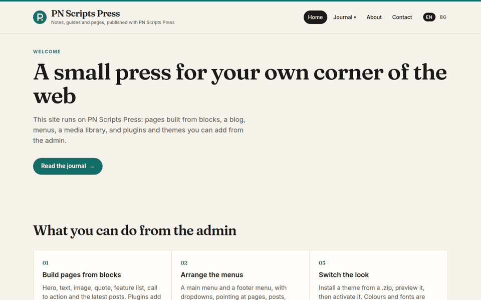
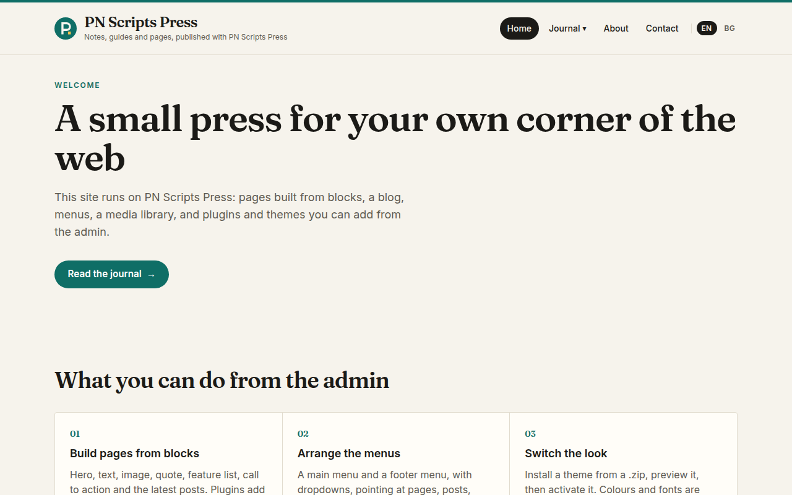
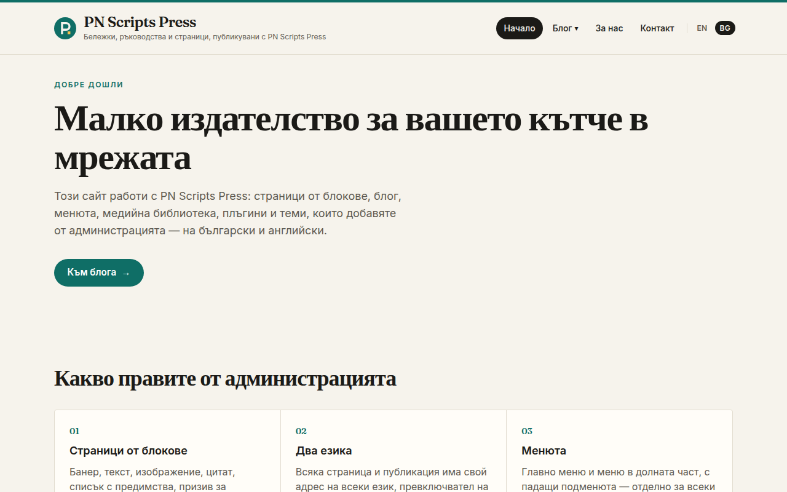
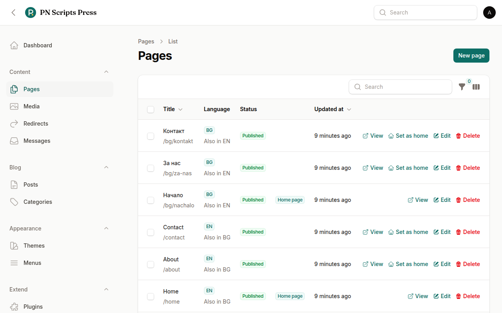
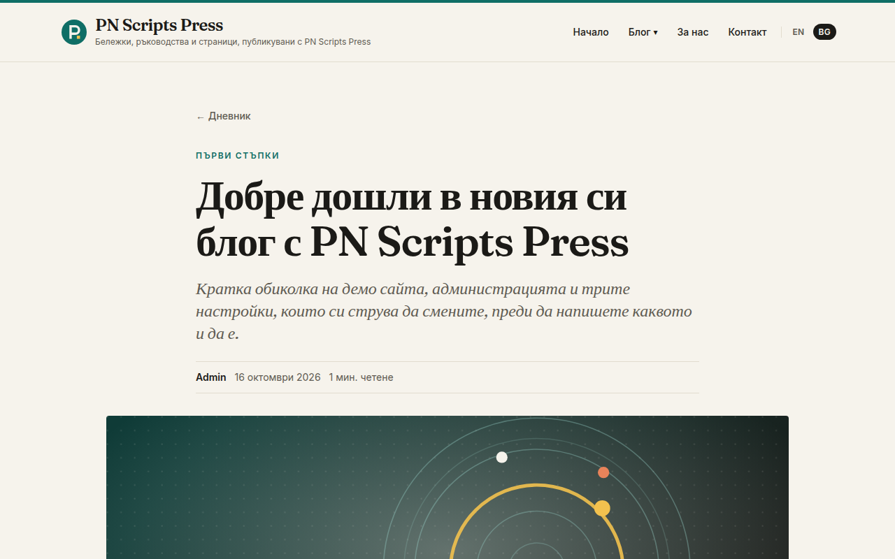

# PN Scripts Press

PN Scripts Press is a [PN Scripts](https://pnscripts.com) product ([product page](https://pnscripts.com/products/pn-press)). It was previously published as Laravel Blog CMS.

A Laravel CMS with WordPress-style plugins and themes: pages built from blocks, a blog, content in several languages (EN/BG out of the box), menus, a media library, SEO fields, page revisions, users and roles, and an admin built on [Filament](https://filamentphp.com) at `/admin`. Plugins and themes install from a `.zip` (or a folder) and are switched on and off in the admin.

Built with Laravel 13, Filament 5, Livewire 4, Spatie Permission and Tailwind CSS 4.

Repository: [github.com/pnscripts/pn-press](https://github.com/pnscripts/pn-press)

## Screenshots



| English | Bulgarian (`/bg`) |
|---|---|
|  |  |
|  |  |

More in [docs/demo](docs/demo) (admin dashboard, Translate dialog, menus and settings per language, phone views). All taken from a fresh install with the demo seed.

## Requirements

- PHP 8.4+ with the `zip`, `pdo_sqlite` (or `pdo_mysql` / `pdo_pgsql`), `mbstring`, `intl` and `fileinfo` extensions
- Composer
- Node.js 18+ and npm (for Vite / Tailwind in development)
- SQLite (default) or MySQL / PostgreSQL

## Install

From the latest release ([GitHub releases](https://github.com/pnscripts/pn-press/releases)):

```bash
composer create-project pnscripts/pn-press my-site \
    --repository='{"type":"vcs","url":"https://github.com/pnscripts/pn-press"}'
cd my-site
php artisan db:seed     # optional: demo content in English and Bulgarian + the admin account below
npm install
npm run build
php artisan serve
```

Without the demo seed there is no account yet: create yours with `php artisan press:admin you@example.com` (it asks for a password).

`create-project` installs the newest tagged release, copies `.env.example` to `.env`, generates the app key, creates `database/database.sqlite` and runs the migrations. (Once the package is on Packagist the `--repository` line is not needed.)

Or with git:

```bash
git clone https://github.com/pnscripts/pn-press.git my-site
cd my-site
composer install
cp .env.example .env
php artisan key:generate
php artisan migrate --seed
npm install
npm run build
php artisan serve
```

Visit [http://127.0.0.1:8000](http://127.0.0.1:8000) for the demo site, and [/bg](http://127.0.0.1:8000/bg) for its Bulgarian version. The seed creates a home page, About and Contact pages (in English and Bulgarian, linked as translations), the menus, activates the Folio theme and the two example plugins.

**MySQL / PostgreSQL:** set `DB_CONNECTION=mysql` (or `pgsql`), `DB_HOST`, `DB_PORT`, `DB_DATABASE`, `DB_USERNAME`, `DB_PASSWORD` in `.env`, create the empty database, then `php artisan migrate --seed`.

**Languages:** `.env.example` sets `PRESS_LOCALES=en,bg`. Use `PRESS_LOCALES=en` for a single-language site. See [docs/multilingual.md](docs/multilingual.md).

## Admin

- URL: `/admin`
- Email: `admin@example.com`
- Password: `password`

These exist only after `php artisan db:seed` (or `migrate --seed`). Change them before any real deployment, or create your own account with `php artisan press:admin you@example.com`.

Filament login stays at `/admin`. Only users with the `admin` or `editor` role can open the panel.

## What is included

**Content**

- Pages built from blocks: hero, text, image, feature list, quote, call to action, latest posts (plugins add more). Child pages (`/services/design`), drafts, scheduled publishing, a page template per page, and a home page chosen in Settings.
- Revisions: every page save keeps the previous version (last 25); restore any of them from the page editor.
- Blog: posts and categories at `/blog`, `/blog/{slug}`, `/category/{slug}`, with drafts and scheduled posts hidden from visitors.
- SEO: meta title, description, social image and "hide from search engines" on pages; meta title and description on posts; canonical and Open Graph tags; `/sitemap.xml` from the SEO Sitemap plugin.
- Menus: a main and a footer location, with nested dropdowns (three levels by default, `press.menus.max_depth`), pointing at pages, posts, categories, the blog or any safe link. Dropdowns work without JavaScript and by keyboard (Enter, Escape, arrow keys). Links to unpublished pages are left out automatically.
- Media library: upload images and PDFs, with alt text and captions. Image blocks pick from the library with thumbnails, search and a browse grid, or upload a new image on the spot.
- Languages: every page, post, category and menu has a language; the default one lives at `/`, the others under `/bg/…`. A **Translate** action copies an item into another language as a linked draft; each language has its own slugs, menus, site name, tagline and home page; a language switcher, `hreflang` links and sitemap alternates connect the versions. Front-end texts in English and Bulgarian. See [docs/multilingual.md](docs/multilingual.md).
- Redirects (Content → Redirects): send old addresses to new ones (301/302/307/308) with a hit counter. When a published page or post changes its address, a 301 from the old one is added automatically. Redirects only answer addresses that would otherwise be "not found".
- Settings: site name (a fresh install is called "PN Scripts Press"), tagline, footer text, home page, posts per page. Plugins add their own sections.
- Page cache: anonymous visitors get pages from a full-page cache (`X-Press-Cache: HIT`). Entries expire when the next scheduled post or page goes live, and every change to content, menus, settings, plugins or themes clears them, so scheduled publishing and edits show on time. Pages with a form, signed-in users, theme previews and unknown query strings are never cached. On when `APP_DEBUG=false` (or `PRESS_PAGE_CACHE=true`); after deploying new theme or view files run `php artisan press:page-cache clear`.
- Two-factor sign-in: every admin user can add an authenticator app (with recovery codes) on their profile page; `PRESS_REQUIRE_2FA=true` makes it mandatory.
- Users and roles: `admin` can do everything; `editor` manages pages, posts, media and menus. Capabilities: `manage plugins`, `manage themes`, `manage settings`, `manage users`, `manage menus`, `manage pages`, `manage media`.

**Plugins** (Extend → Plugins, or `php artisan press:plugin`)

- A plugin is a folder in `plugins/` with a `plugin.json`: its own PSR-4 namespace, a Laravel service provider, views, migrations, a route file (works with `php artisan route:cache`) and admin screens (a Filament plugin class adding resources, pages and navigation).
- Dependencies: `requires.plugins`, `requires.php` and `requires.extensions` in `plugin.json`; a plugin activates only when what it needs is there, and a plugin that others need cannot be switched off under them.
- Update notices: the admin shows when a newer PN Scripts Press, plugin or theme exists (daily `press:check-updates`; plugins and themes opt in with `update_url`). Nothing is downloaded or installed automatically.
- Install from an uploaded `.zip` or a folder on the server, then activate (runs its migrations), deactivate, or uninstall (rolls its tables back, removes its settings and folder). Replacing a plugin with a newer version runs its new migrations on the next request.
- Actions and filters, WordPress style: `add_action`, `do_action`, `add_filter`, `apply_filters`, and `@hook('head')` in Blade.
- Examples: **Contact Form** (a block, a route, its own table, a settings section, a honeypot, a rate limit and a *Messages* inbox to read, mark handled, delete and export messages as CSV) and **SEO Sitemap** (`/sitemap.xml` and a head link).

**Themes** (Appearance → Themes, or `php artisan press:theme`)

- A theme is a folder in `themes/` with a `theme.json`. Any view in its `views/` replaces the default with the same name.
- Settings declared in `theme.json` (colours, choices, toggles, text) are edited in the admin and reach the page as CSS variables and `data-*` attributes.
- Child themes: `"parent": "folio"` inherits the parent's views, assets, settings and templates; the child ships only what it changes.
- Preview a theme before activating it, add page templates, ship a stylesheet and screenshot.
- Two themes: **Folio** (default; warm paper, ink type, teal accent, serif headings) and **Nocturne** (dark, violet accent, centred masthead).

**Package security**

Uploads are checked before anything is written: archive size, entry count, unpacked size and compression ratio; no absolute paths, `..`, backslashes, symlinks or hidden files; only allowed file types (themes may contain PHP only as `*.blade.php`). Only users with `manage plugins` / `manage themes` can install. Nothing is ever downloaded from the internet. Plugins and themes run with full access to your site, so install only code you trust; set `PRESS_PACKAGE_UPLOADS=false` to turn uploads off and install over SSH instead.

Guides: [writing a plugin](docs/plugins.md), [writing a theme](docs/themes.md) and [languages](docs/multilingual.md).

## What is not included

- Comments, multi-tenancy, a 404 log
- Scheduled backups (planned next), an admin in languages other than English
- Machine translation of content
- A plugin or theme directory, automatic updates or remote installs (on purpose)
- Production-ready Telescope access (the `viewTelescope` allowlist is empty on purpose)

## Tests

```bash
php artisan test
composer analyse   # Larastan (PHPStan level 5)
```

## More from PN Scripts

- [PN Scripts Invoice](https://github.com/pnscripts/pn-invoice): free PHP library to write and validate EN 16931 e-invoices (UBL and CII).
- [Laravel and Filament upgrades and care](https://pnscripts.com/services/laravel-filament-care): fixed-price upgrades to Laravel 13 and Filament 5, and monthly care plans.
- All products: [pnscripts.com/products](https://pnscripts.com/products)

## License

MIT. Copyright 2026 ПН СКРИПТС ЕООД (PN Scripts). See [LICENSE](LICENSE).
